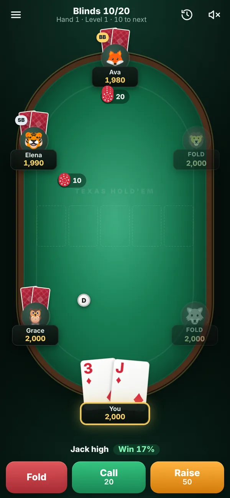
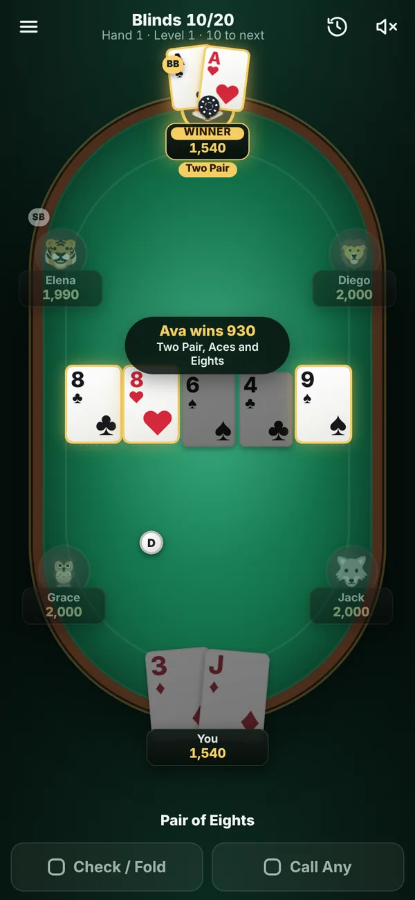
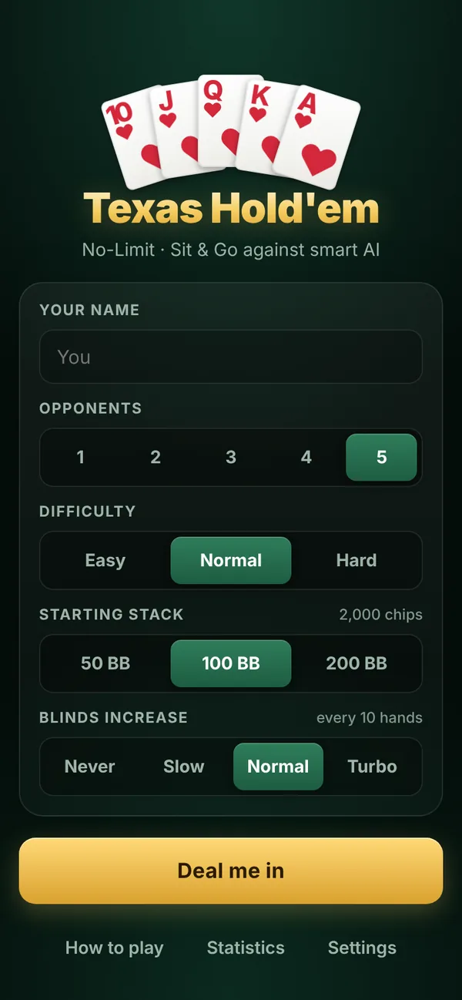
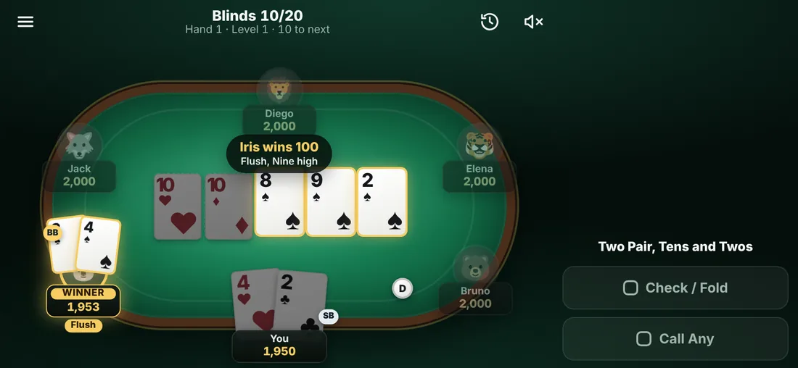

# ♠️ Texas Hold'em — mobile poker against AI

A polished, mobile-first **No-Limit Texas Hold'em** game you can play in any browser — phone, tablet or desktop.
Sit down at a Sit & Go tournament against up to five computer opponents with distinct personalities, and play until
one player has all the chips.

No sign-up, no ads, no build step and no dependencies: it's plain HTML, CSS and JavaScript, and it works offline once loaded.

<p align="center">
  
  
  
</p>
<p align="center">
  
</p>

## Features

**Real poker rules**
- Full No-Limit Hold'em: blinds, pre-flop/flop/turn/river betting, showdown.
- Correct minimum raises, including all-in raises that don't reopen the betting (and several that add up to a full raise, which do).
- Side pots for any number of all-ins, uncalled bets returned, split pots with the odd chip to the first winner left of the button.
- Tournament structure with rising blinds (Never / Slow / Normal / Turbo) and finishing places.

**Smart opponents**
- 12 opponents with five play styles: *Rock*, *Shark*, *Maniac*, *Calling Station* and *Pro*.
- Decisions combine a pre-flop hand chart, position, pot odds and Monte Carlo equity against each opponent's likely range
  (a pre-flop 3-bet means a strong hand; a bet on the turn rarely means nothing).
- Push-or-fold play when short-stacked, continuation bets, slow-plays, bluffs and semi-bluffs.
- Three difficulty levels: Easy, Normal and Hard.

**Made for phones**
- Portrait-first table that adapts to any screen; in landscape the controls dock to the side.
- Big thumb-friendly buttons, a bet slider with *½ Pot · ¾ Pot · Pot · All-in* presets, and pre-actions (*Check/Fold*, *Call Any*).
- Respects notches and home indicators (safe areas), keeps the screen awake during play, vibrates on your turn (Android).
- Installable as an app (PWA): "Add to Home Screen" and it runs full-screen and offline.

**Polish**
- Animated dealing, 3-D card flips, chips that fly to the pot and the winner, winning cards highlighted.
- Synthesized sound effects (no audio files), confetti when you win the tournament.
- Your hand's name and win probability shown as you play (can be turned off).
- Hand history log, lifetime statistics, four-color deck option, adjustable game speed.
- Progress is saved after every hand — close the tab and pick up where you left off.
- Keyboard shortcuts on desktop: **F** fold · **C** check/call · **R** bet/raise · **A** all-in · **Enter** confirm · **↑/↓** adjust.

## Play it

### On GitHub Pages (free hosting)

1. In this repository, open **Settings → Pages**.
2. Under **Build and deployment**, set **Source** to **Deploy from a branch**.
3. Choose the branch containing this code and the **/ (root)** folder, then **Save**.

After a minute the game is live at **https://jeerawish.github.io/Jeerawish/**. Open it on your phone and use
*Add to Home Screen* to install it like an app.

### Locally

Any static file server works (ES modules need `http://`, not `file://`):

```bash
npm start            # serves on http://localhost:8080
# or
python3 -m http.server 8080
```

## Tests

The rules engine, hand evaluator and AI are covered by unit tests (Node 18+ — no install needed):

```bash
npm test
```

They include an exhaustive check of all 2,598,960 five-card hands against the known category counts, 7-card
evaluation against brute force, side-pot and min-raise scenarios, a randomized fuzz test that verifies chips are
never created or lost, and full bot-vs-bot tournaments at every difficulty.

## Project structure

```
index.html            App shell: lobby, table, controls and dialogs
css/style.css         All styling (mobile-first, landscape and desktop variants)
js/cards.js           Cards, deck and cryptographically secure shuffling
js/evaluator.js       Fast 5–7 card hand evaluator and hand descriptions
js/engine.js          Game engine: betting rounds, side pots, showdown, blinds, eliminations
js/ai.js              Computer opponents: hand charts, equity simulation, personalities
js/ui.js              Table layout, card/chip rendering, animations, player controls
js/main.js            App controller: lobby, game loop, saving, dialogs, statistics
js/sound.js           Web Audio sound effects
js/storage.js         Safe localStorage helpers
sw.js                 Service worker for offline play
manifest.webmanifest  PWA manifest and icons
tests/                Node test suites
```
